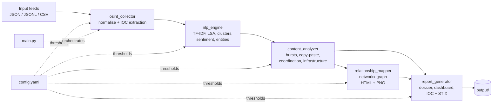

# AMESIT - The Information Operations Engine

AMESIT is an analytical framework for SOC and threat-intelligence analysts. It ingests open-source social
metadata and domain-registration logs, then detects **coordinated behaviour, copy-paste campaigns, narrative
amplification and temporal bursts**, maps **actor / narrative / infrastructure relationships**, and produces an
analyst-ready **dashboard, PDF + Markdown dossier and blocklist-ready indicators (CSV + STIX 2.1)**.

> **All bundled data is synthetic.** The "Operation TAPLINE" campaign against the fictional city of Port Meridian
> uses RFC 2606 `.example` domains, RFC 5737 documentation IPs and RFC 5398 documentation ASNs. No real person,
> organisation, election or platform is depicted.

* Windows 10 / 11 first: no WSL, Docker, bash or compiler. `pathlib` everywhere, UTF-8 everywhere.
* Lightweight stack: scikit-learn, networkx, pandas, matplotlib, pyvis, reportlab, with automatic fallbacks.
* Transparent: every score decomposes into named indicators whose weights live in `config.yaml`.

---

## 1. Quick start (Windows)

1. Install Python 3.10 - 3.13 from <https://www.python.org/downloads/windows/> (tick **Add python.exe to PATH**).
2. Extract `AMESIT.zip` and **double-click `setup_and_run.bat`**.

The script creates `venv\`, installs `requirements.txt` (with an automatic unpinned retry if a pin has no wheel
for your Python), generates the sample dataset, runs the full pipeline and opens `output\dashboard.html`.
Options: `setup_and_run.bat --reinstall`, `setup_and_run.bat --nobrowser`.

### Manual / macOS / Linux

```bat
python -m venv venv
venv\Scripts\activate            :: macOS/Linux: source venv/bin/activate
pip install -r requirements.txt
python main.py generate-data
python main.py run --open
python main.py selftest          :: runs the pipeline and asserts against the synthetic ground truth
```

### CLI

| Command | Purpose |
|---|---|
| `python main.py generate-data [--out F] [--seed N]` | write the deterministic synthetic dataset |
| `python main.py run [--input F] [--output D] [--open] [--skip-graph] [--skip-pdf]` | full pipeline (default command) |
| `python main.py selftest` | run + 12 pass/fail checks (detection quality and output files) |
| `--config other.yaml`, `-v` | alternative config, debug logging |

Input may be `.json`, `.jsonl`, `.csv` or a folder of CSVs (`posts.csv`, `accounts.csv`, `domains.csv`).
Column aliases (e.g. `user_id`/`account_id`, `created_at`/`timestamp`) are resolved automatically.

---

## 2. Architecture



```
 INPUT --> [1 OSINT COLLECTOR] --> [2 NLP ENGINE] --> [3 CONTENT ANALYZER] --+--> [4 RELATIONSHIP MAPPER]
 json/csv   UTC, Unicode, URLs     TF-IDF+char+LSA     bursts (median/MAD)    |     graphs/*.html *.png
            IOCs, account feats    k-means clusters    copy-paste groups      |
                                   sentiment, NER      5-channel coordination |
                                                       infrastructure risk    +--> [5 REPORT GENERATOR]
                                                       account suspicion            dashboard, PDF/MD dossier,
                                                                                    iocs_flagged.csv, STIX 2.1
```

### Repository layout

```
AMESIT/
  README.md  setup_and_run.bat  requirements.txt  config.yaml  main.py
  data/sample_io_campaign.json          synthetic operation (2,389 posts, 106 accounts, 17 domains)
  src/
    __init__.py
    osint_collector.py                  ingestion, normalisation, IOC extraction, sample generator
    nlp_engine.py                       TF-IDF similarity, narrative clustering, sentiment, entities
    content_analyzer.py                 bursts, copy-paste, coordination, infrastructure, scoring
    relationship_mapper.py              graph construction, pyvis HTML, matplotlib PNG, GraphML/CSV
    report_generator.py                 PDF + Markdown dossier, dashboard, IOC/STIX, project report
  docs/AMESIT_Project_Report.pdf        formal project report (rebuilt with live results on each run)
  output/                               created at run time
```

---

## 3. Analysis walkthrough

Every step below is what `python main.py run` does; each can be inspected in `output/`.

1. **Collect and normalise (`osint_collector`).** Timestamps to UTC; text NFKC-normalised, zero-width characters
   removed, homoglyph tokens folded; URLs canonicalised (tracking parameters, `www`, fragments); de-fanged
   indicators (`hxxp`, `[.]`) restored. URLs, domains, IPv4, e-mail, hashes, hashtags and mentions are extracted from
   posts *and* bios into an IOC table with first/last seen and account counts. Account features: age at first post,
   follower ratio, handle pattern, handle changes. A data-quality report records dropped rows and the input SHA-256.
2. **NLP (`nlp_engine`).** Word TF-IDF measures near-duplicate wording; character n-grams resist obfuscation;
   LSA (SVD) captures paraphrase. Posts are clustered (k-means, k chosen by silhouette) into *narratives* labelled by
   their top terms. Sentiment uses VADER plus an influence-operation lexicon (fallback: built-in lexicon). Entities use
   spaCy if installed, otherwise a rule-based extractor.
3. **Temporal bursts.** 15-minute bins, rolling median/MAD robust z-score, merged into events; run globally and per
   narrative so small waves are not drowned by baseline traffic.
4. **Copy-paste and coordination.** Hashed word-shingle Jaccard groups near-duplicate posts. Account pairs gather
   evidence in five channels (identical text, shared URL, co-repost, paraphrase, burst cascade); a weighted pair graph
   is split by Louvain into communities, each profiled and graded by the number of independent *evidence families*.
5. **Infrastructure.** Domain age at first share; shared registrar / nameserver / ASN / IP / registrant hash / TLS
   fingerprint / registration window; look-alike scoring against long-established domains; 0-100 risk score.
6. **Burst classification.** A coordination index (coordinated-account share, duplicate share, young-account share,
   flagged-domain share, text similarity) labels each burst *coordinated* or *organic* - the main false-positive control
   (the bundled data includes a genuine viral festival burst that must not be flagged).
7. **Account scoring.** Weighted indicators give each account 0-100 with human-readable reasons. An account is flagged
   only if it sits in a community backed by at least one independent evidence family.
8. **Relationship map (`relationship_mapper`).** Multi-layer graph: actors, narratives, link domains, infrastructure
   attributes; edges are coordination, posts-about, shares-link, infra-link, interacts. Exports: offline interactive HTML
   (pyvis, JavaScript inlined), four PNG diagrams, GraphML, node/edge/centrality CSV.
9. **Report (`report_generator`).** Key judgments with confidence levels, tradecraft mapping (DISARM-style behaviours,
   by name), IOC exports, recommended actions, limitations.

### Outputs

| File | Use |
|---|---|
| `output/dashboard.html` | self-contained dashboard (KPIs, charts, tables, embedded network) |
| `output/AMESIT_Intelligence_Dossier.pdf` / `.md` | analyst dossier with key judgments |
| `output/graphs/amesit_network.html`, `amesit_actor_network.html` | interactive relationship maps |
| `output/graphs/*.png`, `*.graphml`, `graph_*.csv` | static diagrams and Gephi/Neo4j-ready tables |
| `output/iocs/iocs_flagged.csv`, `iocs_stix.json` | blocklist-ready indicators; STIX 2.1 bundle |
| `output/data/*.csv` | every analytic table (accounts, bursts, communities, narratives, domains, ...) |
| `output/run_summary.json`, `amesit.log` | machine-readable run summary and log |
| `docs/AMESIT_Project_Report.pdf` | formal project report |

---

## 4. Validation on the synthetic operation

The generator embeds a ground truth (`synthetic_ground_truth`) so the pipeline can grade itself
(`python main.py selftest`). With the pinned dependencies:

| Measure | Result |
|---|---|
| Campaign accounts | precision 1.00, recall 0.88, F1 0.94 |
| Campaign domains | 6 / 6 found, no false positives |
| Coordinated waves | 6 / 6 detected |
| Viral festival burst (false-positive trap) | classified organic |
| Organic accounts wrongly flagged | 0 |

Recall is lowest for *persona* accounts (4 of 7): they post a few unique testimonials, so they share little text
or timing with the rest of the network. That is a realistic weakness, not a tuning artefact.

## 5. Configuration

`config.yaml` holds every threshold (burst z-score, similarity cut-offs, lag windows, evidence weights, risk and
suspicion tiers, graph limits). Any missing key falls back to the module default. To use your own data, point
`paths.input` (or `--input`) at it and re-run; recalibrate against a labelled baseline from your environment.

## 6. Windows notes and troubleshooting

* Console output is forced to UTF-8 and ASCII-safe; the batch file is ASCII-only with CRLF endings.
* No compilation is needed - all dependencies ship Windows wheels. Python 3.14+ may lack wheels for a pinned version; the
  batch file then retries unpinned automatically.
* Corporate proxy: set `HTTPS_PROXY` before running the batch file. Offline: `pip download` the requirements on a
  connected machine and install from that folder.
* If `output\` files are locked, close the open PDF / HTML and re-run.
* Optional extras: `pip install spacy && python -m spacy download en_core_web_sm` (better entities), `pip install plotly`
  (graph fallback). Neither is required.
* Different library versions can change cluster boundaries and therefore scores slightly; use the pinned versions for
  reproducible results.

## 7. Limitations and responsible use

* AMESIT detects **patterns of coordination**; it does not attribute activity to an actor or intent.
* Legitimate coordination (advocacy, brand teams, fandoms) can look similar. Keep an analyst in the loop before any
  enforcement, takedown request or public statement.
* Similarity is lexical/LSA based: heavy paraphrase, translation and image-only content reduce recall.
* Thresholds are tuned on synthetic data and need recalibration on real traffic. Collect data lawfully and within platform
  terms; minimise personal data.
* The DISARM-style mapping is indicative; check it against the current DISARM release before external use.

## 8. Roadmap

Multilingual embeddings and image hashing; streaming/incremental detection with SIEM/SOAR hooks; platform, passive-DNS and
certificate-transparency connectors; analyst feedback loop for threshold learning; a library of synthetic scenarios for
regression testing.
