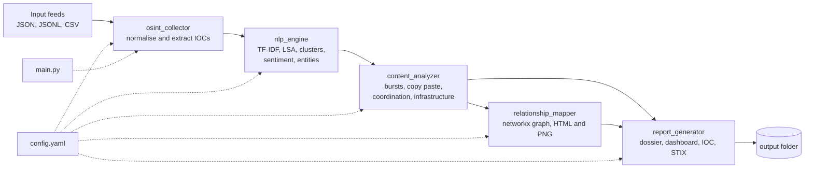
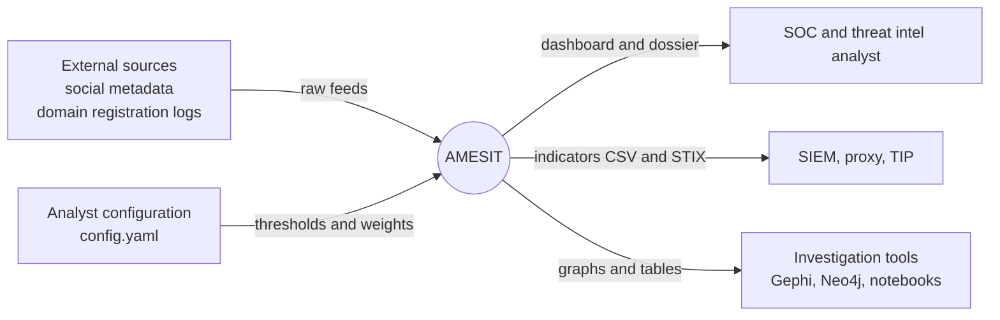
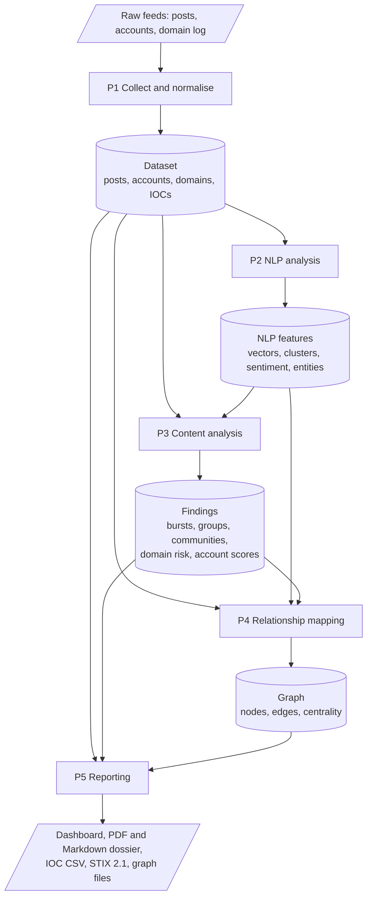
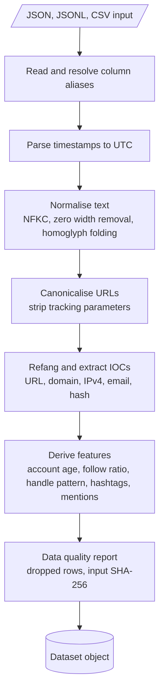
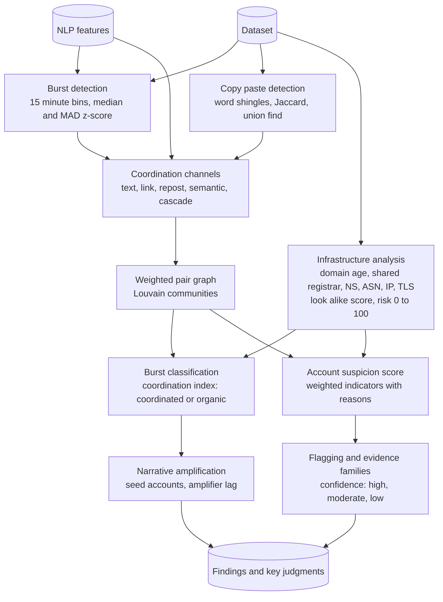
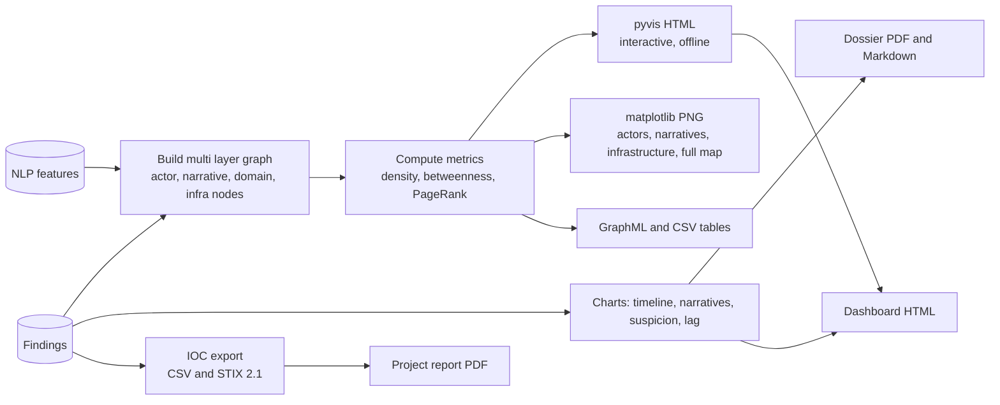
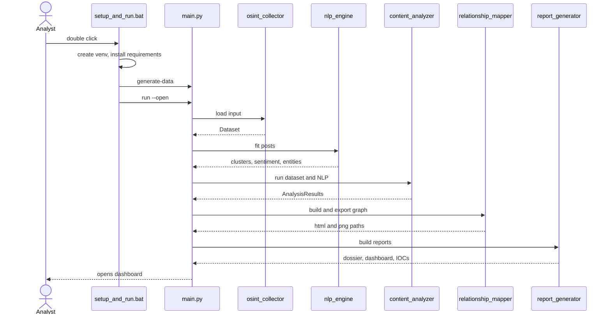

AMESIT - The Information Operations Engine
==========================================

AMESIT is a Python framework for SOC and threat intelligence analysts. It ingests open source social media metadata and domain registration logs, detects coordinated information operations, maps the relationships between actors, narratives and infrastructure, and produces an analyst ready dashboard, a PDF and Markdown dossier, and blocklist ready indicators (CSV and STIX 2.1).

All bundled data is synthetic. The sample campaign "Operation TAPLINE" targets the fictional city of Port Meridian and uses RFC 2606 .example domains, RFC 5737 documentation IP addresses and RFC 5398 documentation ASNs. No real person, organisation, election or platform is depicted.

Highlights
----------

- Four pillars: OSINT collection, content analysis, NLP, relationship mapping
- Detects temporal bursts, copy paste campaigns, narrative amplification and multi channel coordination
- Separates coordinated waves from genuine viral events with a coordination index
- Interactive network graphs (pyvis, works offline) and static PNG diagrams (matplotlib)
- Exports flagged indicators as CSV and as a STIX 2.1 bundle
- Windows 10 and 11 first: no WSL, no Docker, no bash, no compiler
- Every score is explainable and every threshold lives in config.yaml

Table of contents
-----------------

1. Quick start
2. Command line usage
3. System architecture
4. Data flow diagrams
5. Project structure
6. Analysis walkthrough
7. Outputs
8. Validation results
9. Configuration
10. Windows notes and troubleshooting
11. Limitations and responsible use
12. Roadmap

Quick start
-----------

Windows 10 or 11

1. Install Python 3.10 to 3.13 from python.org and tick "Add python.exe to PATH".
2. Clone or download this repository.
3. Double click setup_and_run.bat.

The script creates a venv folder, installs requirements.txt (with an automatic unpinned retry if a pinned package has no wheel for your Python version), generates the sample dataset, runs the full pipeline and opens output/dashboard.html.

Script options: setup_and_run.bat --reinstall forces a dependency reinstall, and setup_and_run.bat --nobrowser skips opening the dashboard.

macOS or Linux

```bash
git clone https://github.com/YOUR-USERNAME/AMESIT.git
cd AMESIT
python3 -m venv venv
source venv/bin/activate
pip install -r requirements.txt
python main.py generate-data
python main.py run --open
```

Windows, manual steps

```bat
python -m venv venv
venv\Scripts\activate
pip install -r requirements.txt
python main.py generate-data
python main.py run --open
```

Command line usage
------------------

| Command | Purpose |
|---|---|
| python main.py generate-data | Write the deterministic synthetic dataset |
| python main.py run | Run the full pipeline (default command) |
| python main.py run --input FILE --output DIR | Analyse your own data into a chosen folder |
| python main.py run --open | Open the dashboard when finished |
| python main.py run --skip-graph --skip-pdf | Faster run without graph or PDF output |
| python main.py selftest | Run the pipeline and assert against the synthetic ground truth |
| python main.py --config other.yaml run | Use an alternative configuration |

Accepted input: .json, .jsonl, .csv, or a folder containing posts.csv with optional accounts.csv and domains.csv. Common column aliases are resolved automatically.

System architecture
-------------------



ASCII view

```
 INPUT -> [1 OSINT COLLECTOR] -> [2 NLP ENGINE] -> [3 CONTENT ANALYZER] -+-> [4 RELATIONSHIP MAPPER]
 json     UTC, Unicode, URLs      TF-IDF, char n-gram   bursts            |     graphs html and png
 csv      IOC extraction          LSA, k-means          copy paste        |
          account features        sentiment, entities   coordination      +-> [5 REPORT GENERATOR]
                                                        infrastructure          dashboard, PDF, Markdown
                                                        account scoring         IOC CSV, STIX 2.1
```

Data flow diagrams
------------------

Level 0, context diagram



Level 1, main processes and data stores



Level 2, collection and normalisation (P1)



Level 2, content analysis (P3)



Level 2, relationship mapping and reporting (P4 and P5)



Run sequence



Project structure
-----------------

```
AMESIT/
  README.md
  setup_and_run.bat
  requirements.txt
  config.yaml
  main.py
  data/
    sample_io_campaign.json
  src/
    __init__.py
    osint_collector.py
    nlp_engine.py
    content_analyzer.py
    relationship_mapper.py
    report_generator.py
  docs/
    AMESIT_Project_Report.pdf
  output/                 created at run time
```

| Module | Responsibility |
|---|---|
| osint_collector.py | Ingestion, normalisation, IOC extraction, synthetic data generator |
| nlp_engine.py | TF-IDF similarity, narrative clustering, sentiment, keywords and entities |
| content_analyzer.py | Bursts, copy paste, coordination, infrastructure risk, account scoring |
| relationship_mapper.py | networkx graph, pyvis HTML, matplotlib PNG, GraphML and CSV |
| report_generator.py | PDF and Markdown dossier, dashboard, IOC and STIX export, project report |
| main.py | Command line orchestrator with stage timing and logging |

Analysis walkthrough
--------------------

Step 1, collect and normalise. Timestamps become UTC. Text is NFKC normalised, zero width characters are removed and homoglyph tokens are folded. URLs are canonicalised and tracking parameters stripped. Defanged indicators such as hxxp and [.] are restored. URLs, domains, IPv4 addresses, emails, hashes, hashtags and mentions are extracted from posts and account bios into an IOC table.

Step 2, NLP. Word TF-IDF measures near duplicate wording, character n-grams resist obfuscation and LSA captures paraphrase. Posts are clustered with k-means (k chosen by silhouette score) into narratives labelled by their top terms. Sentiment uses VADER with an influence operation lexicon and falls back to a built in lexicon. Entities use spaCy if installed, otherwise a rule based extractor.

Step 3, temporal bursts. Posts are binned every 15 minutes and a rolling median and MAD robust z-score flags spikes, which are merged into events. Detection runs globally and per narrative so small waves are not hidden by baseline traffic.

Step 4, copy paste and coordination. Hashed word shingles and Jaccard similarity group near duplicate posts. Account pairs gather evidence in five channels: identical text, shared URL, co reposting, paraphrase and burst cascade. A weighted pair graph is split into communities with Louvain, and each community is graded by how many independent evidence families support it.

Step 5, infrastructure. Domain age at first share, shared registrar, nameserver, ASN, IP, registrant hash and TLS fingerprint, a registration window and look alike naming against established domains feed a 0 to 100 risk score.

Step 6, burst classification. A coordination index combines coordinated account share, duplicate text share, young account share, flagged domain share and text similarity. Bursts below the threshold are labelled organic. This is the main false positive control.

Step 7, account scoring. Weighted indicators give each account a 0 to 100 score with readable reasons. An account is flagged only when it sits in a community backed by at least one independent evidence family.

Step 8, relationship map. A multi layer graph links actors, narratives, link domains and infrastructure attributes. Edge types are coordination, posts about, shares link, infra link and interacts.

Step 9, reporting. Key judgments with confidence levels, an indicative tradecraft mapping, IOC exports, recommended actions and limitations are written to the dossier and dashboard.

Outputs
-------

| File | Use |
|---|---|
| output/dashboard.html | Self contained dashboard with KPIs, charts, tables and embedded network |
| output/AMESIT_Intelligence_Dossier.pdf and .md | Analyst dossier with key judgments |
| output/graphs/amesit_network.html | Interactive full relationship map |
| output/graphs/amesit_actor_network.html | Interactive actor only view |
| output/graphs/*.png | Static diagrams: actors, narratives, infrastructure, full map |
| output/graphs/*.graphml and graph_*.csv | Gephi and Neo4j ready tables |
| output/iocs/iocs_flagged.csv | Blocklist ready indicators with confidence and context |
| output/iocs/iocs_stix.json | STIX 2.1 bundle |
| output/data/*.csv | Every analytic table: accounts, bursts, communities, narratives, domains |
| output/run_summary.json and amesit.log | Machine readable summary and log |
| docs/AMESIT_Project_Report.pdf | Formal project report, rebuilt with live results on each run |

Validation results
------------------

The generator embeds a ground truth so the pipeline can grade itself with python main.py selftest. Results with the pinned dependencies:

| Measure | Result |
|---|---|
| Campaign accounts | precision 1.00, recall 0.88, F1 0.94 |
| Campaign domains | 6 of 6 found, no false positives |
| Coordinated waves | 6 of 6 detected |
| Viral festival burst (false positive trap) | classified organic |
| Organic accounts wrongly flagged | 0 |

Recall is lowest for persona accounts (4 of 7 flagged). They post only a few unique testimonials and share little text or timing with the rest of the network. Results on real traffic will differ; recalibrate thresholds against your own labelled baseline.

Configuration
-------------

config.yaml holds every threshold: burst z-score, similarity cut offs, lag windows, evidence weights, risk and suspicion tiers, and graph limits. Any missing key falls back to the module default. To analyse your own data, set paths.input in config.yaml or pass --input.

Windows notes and troubleshooting
---------------------------------

- Console output is forced to UTF-8 and the batch file is ASCII only with CRLF line endings.
- All dependencies ship Windows wheels, so no compiler is needed.
- Python 3.14 or newer may lack wheels for a pinned version. The batch file then retries with unpinned versions automatically.
- Behind a corporate proxy, set HTTPS_PROXY before running the batch file.
- If output files are locked, close the open PDF or HTML file and run again.
- Optional extras: spaCy with en_core_web_sm for better entities, and plotly as a graph fallback. Neither is required.
- Different library versions can shift cluster boundaries and scores slightly. Use the pinned versions for reproducible results.

Limitations and responsible use
-------------------------------

- AMESIT detects patterns of coordination. It does not attribute activity to an actor or intent.
- Legitimate coordination such as advocacy, brand teams and fandoms can look similar. Keep an analyst in the loop before any enforcement, takedown request or public statement.
- Similarity is lexical and LSA based, so heavy paraphrase, translation and image only content reduce recall.
- Thresholds are tuned on synthetic data and need recalibration on real traffic.
- Collect data lawfully and within platform terms, and minimise personal data.
- The tradecraft mapping is indicative. Check it against the current DISARM release before external use.

Roadmap
-------

- Multilingual embeddings and image hashing
- Streaming and incremental detection with SIEM and SOAR hooks
- Connectors for platform APIs, passive DNS and certificate transparency
- Analyst feedback loop for threshold learning
- A library of synthetic scenarios for regression testing

License
-------

Add your preferred license here (for example MIT) before publishing.
